<div align="center">

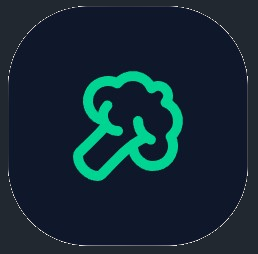

# Colva

**Finanzas personales de punta a punta: gastos, tarjetas, hipoteca UVA, obra, cuentas e inversiones en un solo lugar.**

[](https://colva.vercel.app)


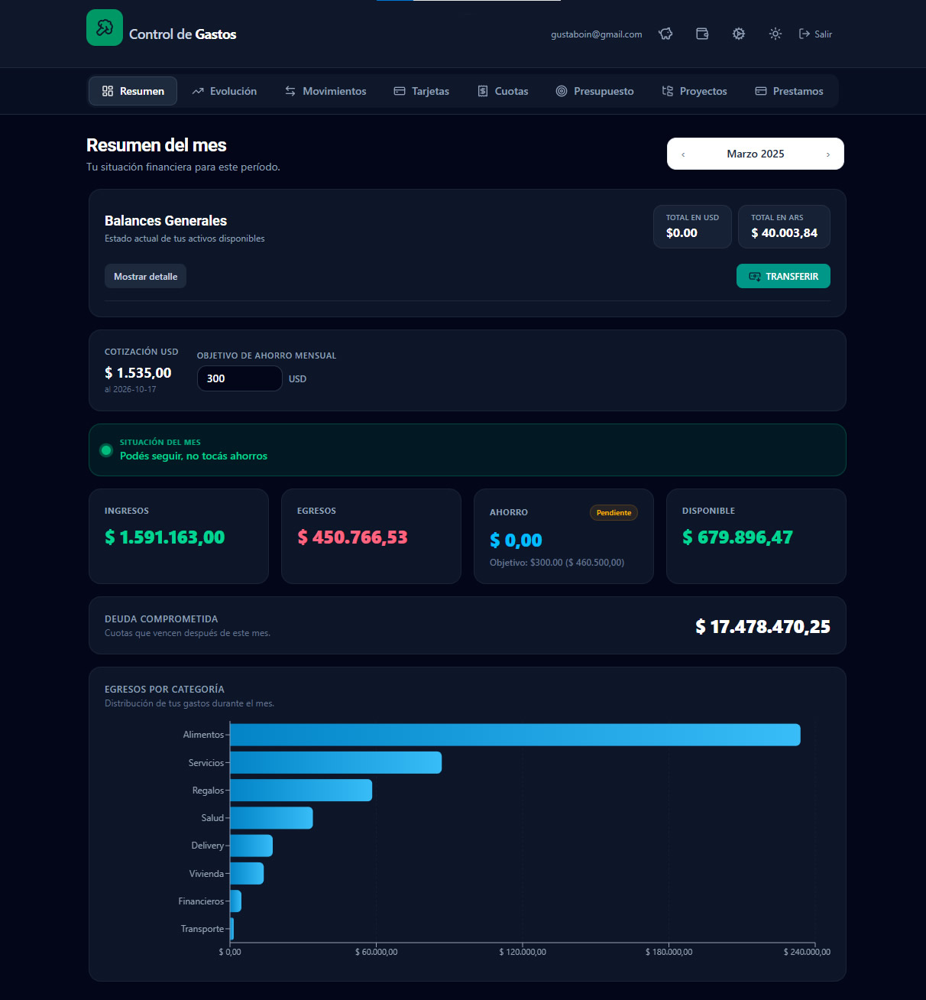

</div>

---

## ¿Qué es?

Colva nació para ordenar varios frentes financieros que no entran en una planilla:
una **obra** en construcción (88 m² en Carlos Casares), una **hipoteca en UVA**,
**tarjetas de crédito** con cuotas, **gastos corrientes**, **cuentas** en pesos y
dólares y una **cartera de inversiones** en CEDEARs repartida en varios brokers.

Todo el cálculo pesado (cuotas mes a mes, saldos, valuación de la cartera, exposición
por país y sector, dividendos estimados) vive en la base de datos como vistas SQL.
El frontend solo las lee y las muestra.

## Secciones

|                 |                                                                                                                                                      |
| --------------- | ---------------------------------------------------------------------------------------------------------------------------------------------------- |
| **Dashboard**   | Semáforo del mes, totales de ingresos y egresos, gráfico por categoría y tipo de cambio.                                                             |
| **Movimientos** | Alta y listado de ingresos y egresos. Los gastos de la obra se marcan como proyecto y se separan del gasto corriente.                                |
| **Cuotas**      | Compras en cuotas con tarjeta. La deuda futura mes a mes la resuelve la base.                                                                        |
| **Presupuesto** | Objetivo contra real por categoría.                                                                                                                  |
| **Evolución**   | Comparación mes a mes por categoría (6, 12 o 24 meses), con tooltip de top 5 y resaltado de meses fuera de lo normal.                                |
| **Préstamos**   | Seguimiento de la hipoteca UVA: cuota actual, saldo en UVA, total pagado, cuota contra inflación. Carga de cada cuota con el UVA del día del débito. |
| **Cuentas**     | Saldo por cuenta y por moneda, transferencias entre cuentas propias y venta o compra de divisas con tipo de cambio.                                  |
| **Inversiones** | Cartera de CEDEARs por broker, exposición, dividendos, fundamentales y ventas FIFO. Protegida con PIN.                                               |

### Dashboard

Resumen del mes con semáforo, tarjetas de métricas y gasto por categoría. El selector
de mes es reutilizable en toda la app.

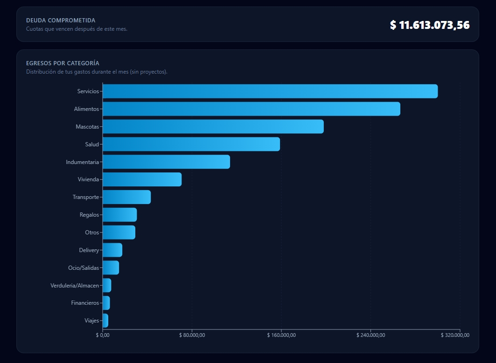

### Movimientos y cuotas

Los `<select>` de categorías y medios de pago se completan solos desde la base, así que
agregar una tarjeta o una categoría nueva no requiere tocar el código.

<table>
  <tr>
    <td>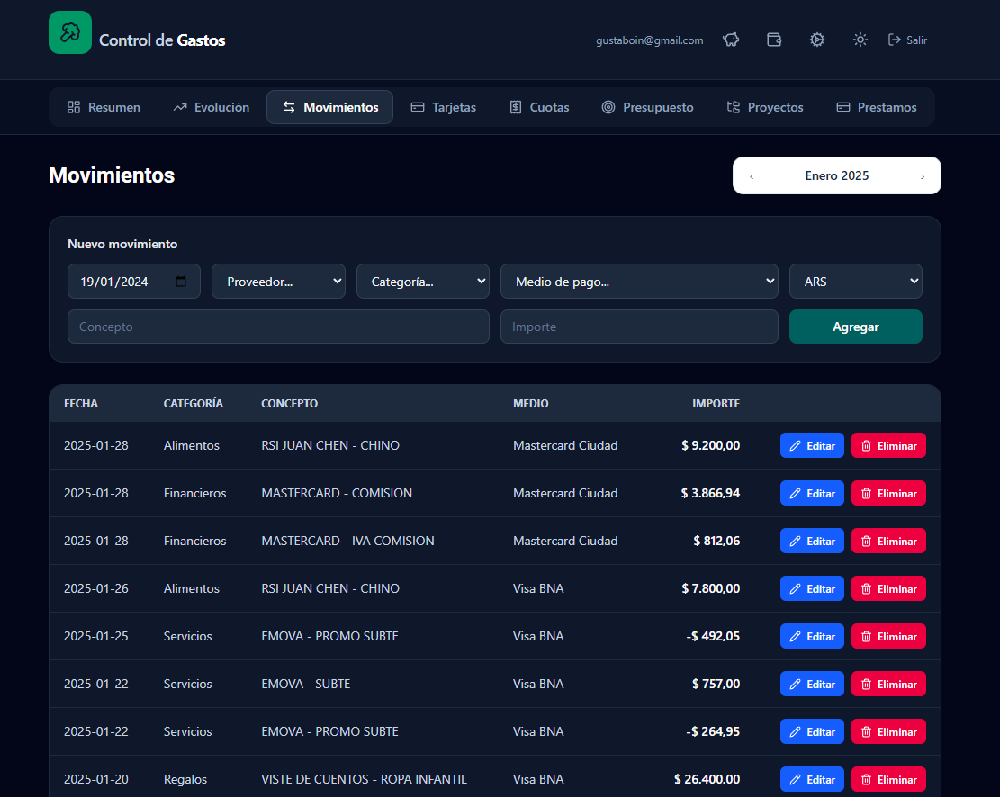</td>
    <td>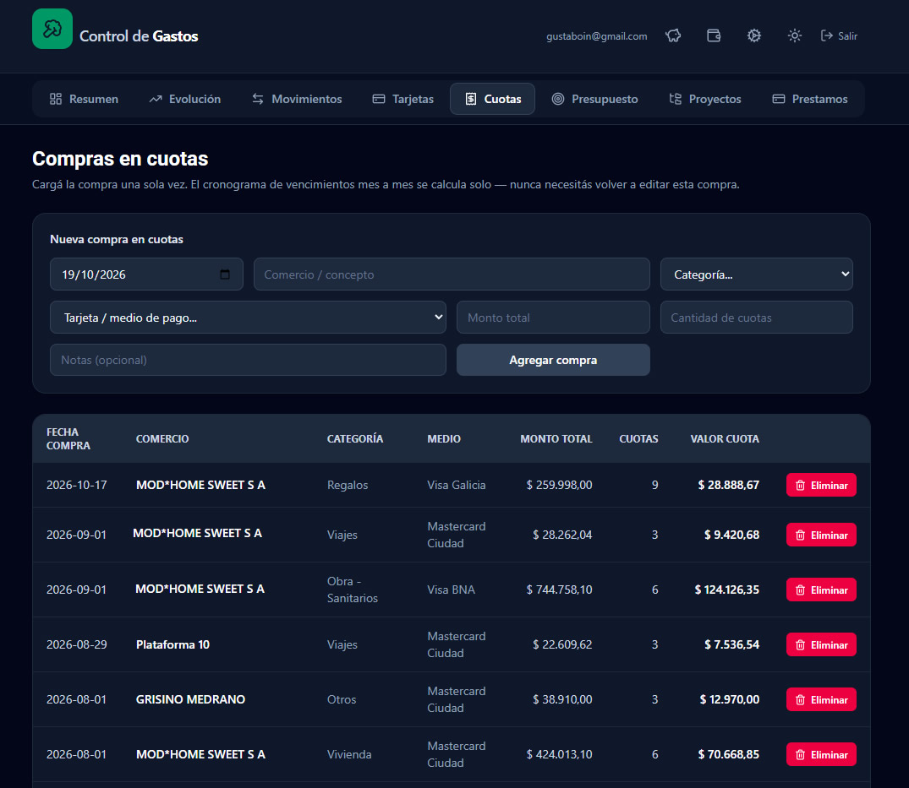</td>
  </tr>
</table>

Los pagos de tarjeta se excluyen del análisis (categorías con `excluir_de_analisis`)
para no contar dos veces un gasto que ya está en Movimientos.

### Presupuesto y evolución

<table>
  <tr>
    <td>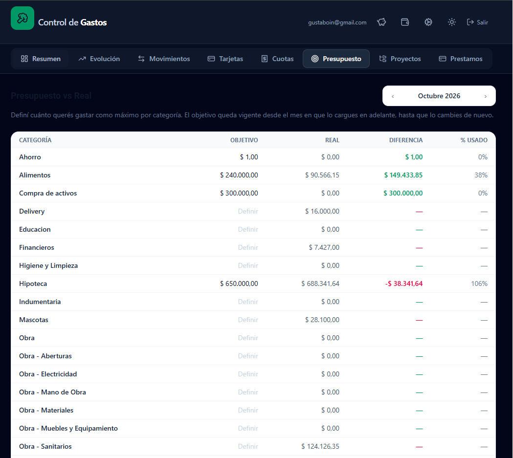</td>
    <td>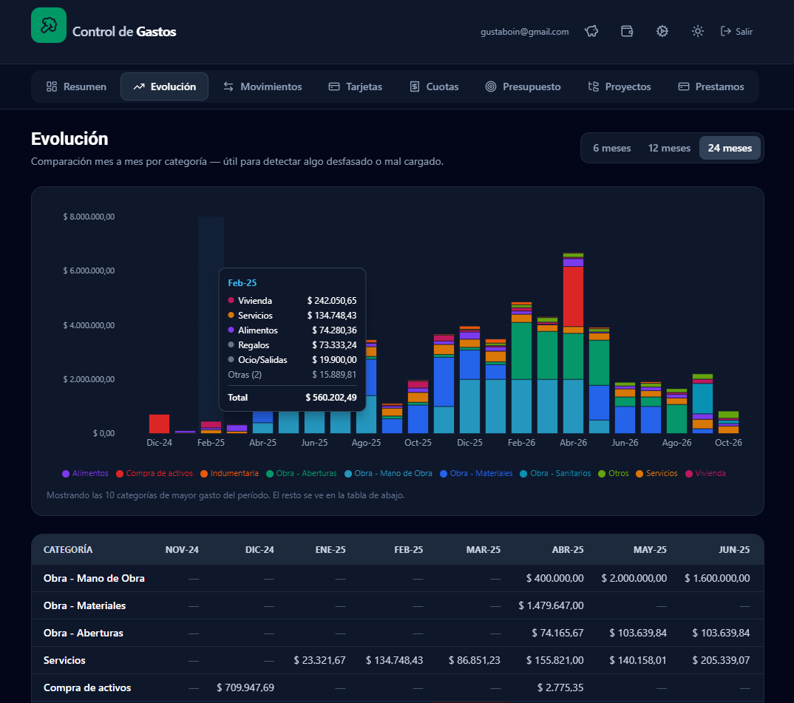</td>
  </tr>
</table>

La pantalla de **Evolución** muestra barras apiladas por mes y una tabla con el detalle.
Al pasar el mouse por un mes, el tooltip lista las 5 categorías de mayor gasto, una línea
"Otras" y el total.

### Préstamos (hipoteca UVA)

La cuota de un crédito UVA se calcula como `importe_uva × valor_uva`. El cuadro de marcha
completo (240 cuotas) está cargado y cada cuota se confirma con el valor UVA del día real
del débito, que no siempre es el día 10: si cae en fin de semana, es el próximo día hábil.
La inflación del mes es opcional y se completa cuando INDEC la publica.

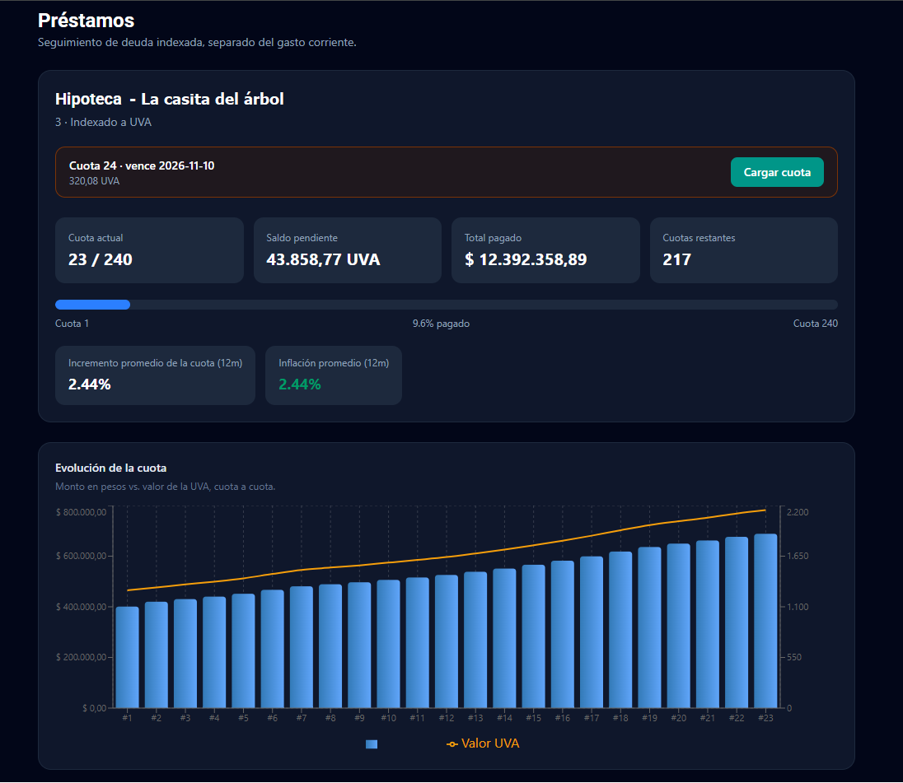

Al cargar una cuota se puede crear automáticamente el egreso en Movimientos, enlazado
a la cuota.

### Cuentas y divisas

Saldos por cuenta y totales por moneda. Las transferencias entre cuentas propias pueden
cambiar de moneda: se elige origen y destino, y si son de monedas distintas aparecen el
tipo de cambio y el importe que entra, calculado y editable.

<table>
  <tr>
    <td>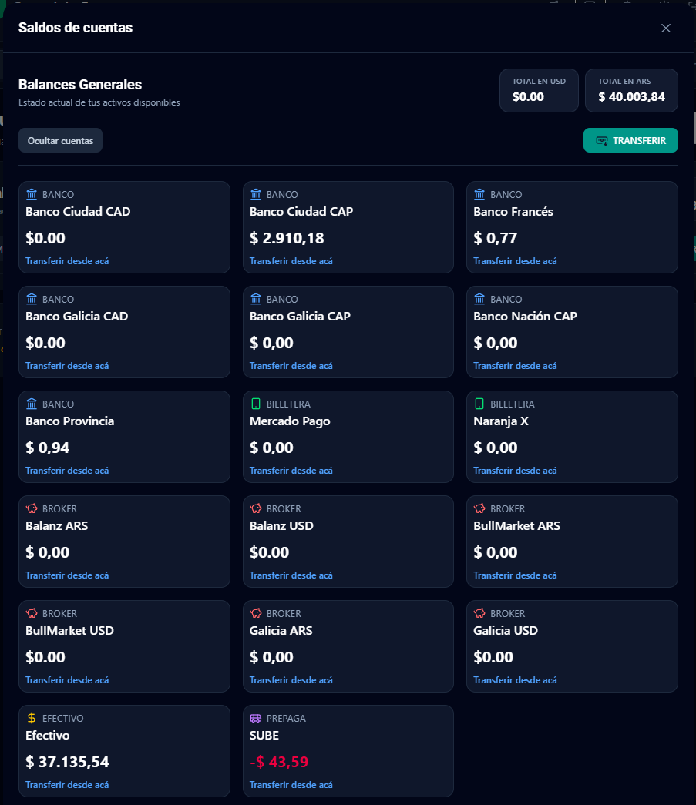</td>
    <td></td>
  </tr>
</table>

### Inversiones

Una sección pensada para una cartera de **CEDEARs** en varios brokers, con ratios que
cambian en el tiempo. Se desbloquea con un PIN.

- **Cartera por activo** con logo, nominales, valor en USD y rendimiento. Filtro por broker o "Todos".
- **Exposición** por rama, país y región, con look-through de ETFs y CEDEARs.
- **Dividendos**: estimación anual de la cartera a partir de las acciones equivalentes que se tienen.
- **Ficha de fundamentales** al tocar un activo: ingresos, márgenes, deuda, flujo de caja y dividendos históricos.
- **Compras y ventas** reales: la venta descuenta por FIFO y acredita el ingreso en la cuenta del broker.

<table>
  <tr>
    <td>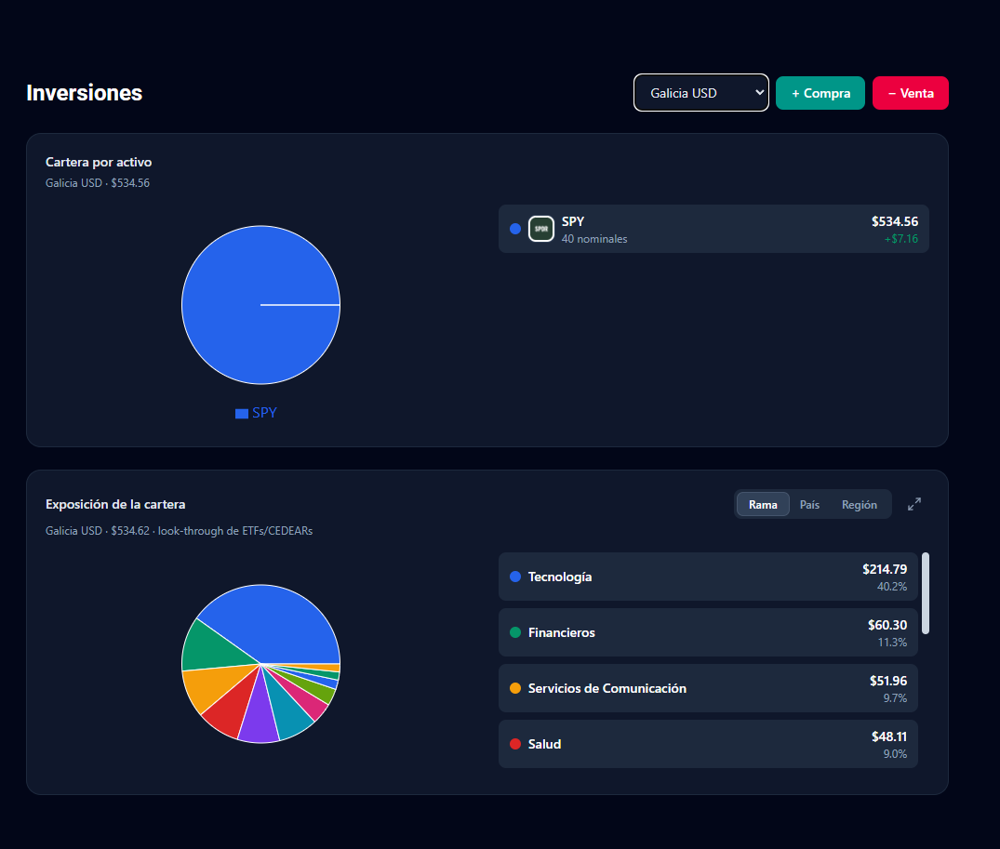</td>
    <td>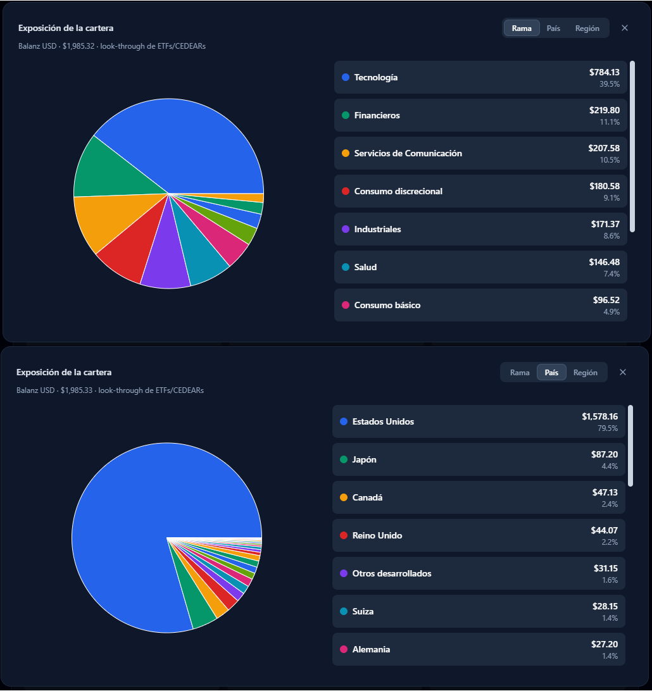</td>
  </tr>
  <tr>
    <td>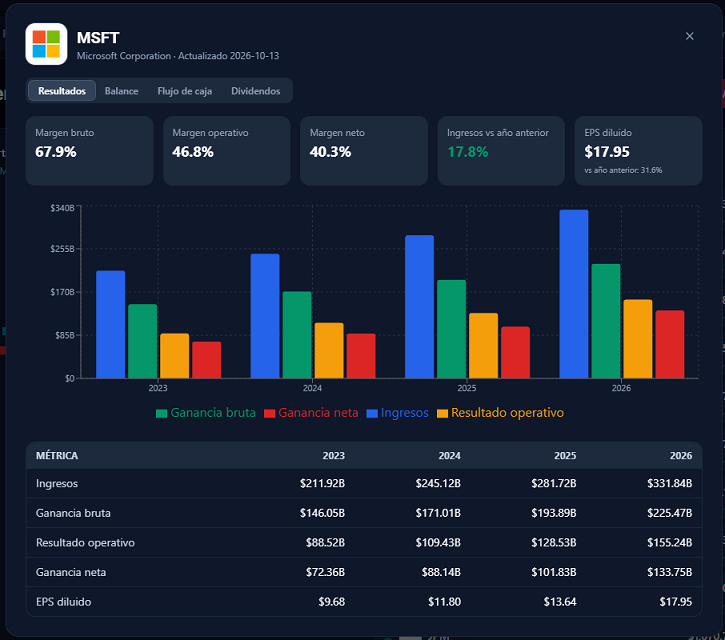</td>
    <td>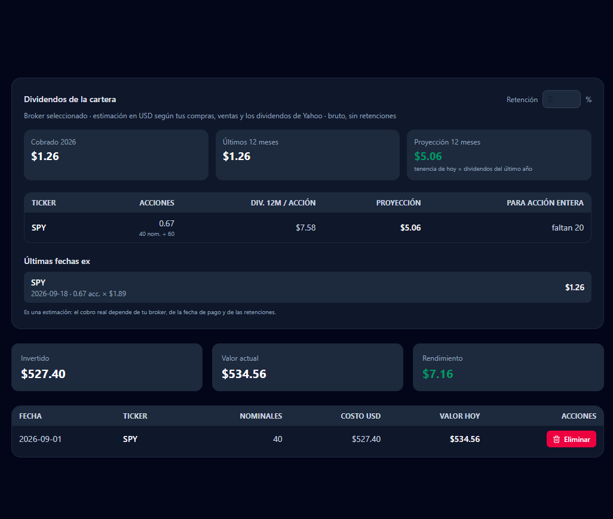</td>
  </tr>
</table>

## Reglas de negocio que vale la pena conocer

- **Ratios de CEDEARs con vigencia.** La tabla `ratios_historicos` guarda cada ratio con
  fecha desde y hasta. La cantidad actual de un boleto es `cantidad × ratio_hoy / ratio_al_comprar`.
- **FIFO respetando el ratio de cada fecha.** La función SQL `recalcular_fifo` reconstruye los
  lotes en orden cronológico: una venta usa la unidad vigente el día en que se hizo y solo
  consume compras anteriores. No importa en qué orden se carguen los boletos viejos.
- **Splits de la acción.** Cuando la acción subyacente se divide, se dividen por el factor
  todos los ratios anteriores a esa fecha. Así los precios ajustados por split y las
  cantidades siguen coherentes.
- **Transferencias con cambio de moneda.** La tabla `transferencias` guarda el importe que
  sale, el importe que entra y el tipo de cambio. Las vistas de saldo suman el importe de destino.
- **Sin doble conteo.** Los pagos de tarjeta y las patas de transferencia no entran en
  los análisis de gasto.

## Arquitectura

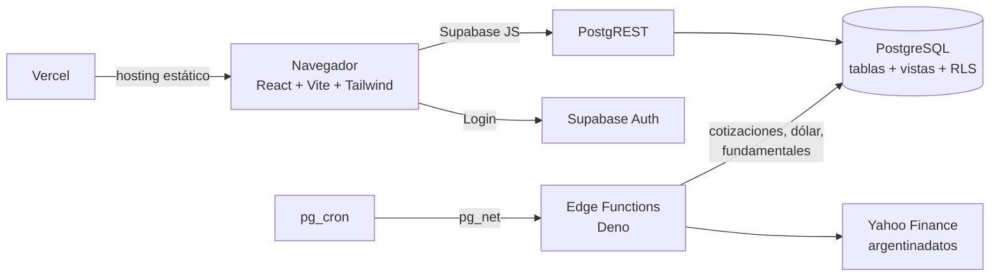

- **Base de datos:** PostgreSQL en Supabase. Las vistas (`vw_*`) concentran el cálculo.
- **Seguridad:** Row Level Security en todas las tablas y vistas, solo usuarios autenticados.
  Cierre de sesión automático por inactividad y PIN extra para Inversiones.
- **Datos externos:** Edge Functions programadas con `pg_cron` traen cotizaciones, dólar
  y fundamentales de forma periódica.
- **Despliegue:** Vercel, con deploy automático desde la rama principal.

## Stack

| Capa           | Tecnología                                                         |
| -------------- | ------------------------------------------------------------------ |
| Frontend       | React, Vite, Tailwind CSS, Recharts, lucide-react                  |
| Backend        | Supabase: PostgreSQL, Auth, Edge Functions (Deno), pg_cron, pg_net |
| Datos externos | Yahoo Finance (no oficial), argentinadatos (UVA e inflación)       |
| Hosting        | Vercel                                                             |

## Instalación

### 1. Dependencias

```bash
npm install
```

### 2. Variables de entorno

```bash
cp .env.example .env
```

Completá `.env` con la URL de tu proyecto de Supabase y la clave pública
(`Project Settings → API → anon public`):

```
VITE_SUPABASE_URL=https://<tu-proyecto>.supabase.co
VITE_SUPABASE_ANON_KEY=<clave anon>
```

La clave `anon` es pública. El acceso real lo protegen las políticas de RLS de la base.

### 3. Base de datos

Los scripts de `supabase/` crean tablas, vistas, políticas y funciones. Ejecutalos en el
SQL Editor de Supabase. Al crear una tabla o vista nueva, recordá:

1. Habilitar RLS y crear la política para usuarios autenticados.
2. Dar `GRANT` sobre la tabla, la secuencia y las vistas.
3. Probar con `begin; set local role authenticated; ...; rollback;`.

### 4. Desarrollo y producción

```bash
npm run dev      # http://localhost:5173
npm run build    # genera dist/
```

## Estructura

```
src/
  lib/
    supabaseClient.js     cliente de Supabase
    AuthContext.jsx       sesión, login/logout y cierre por inactividad
    api.js                consultas generales (movimientos, resúmenes, préstamos)
    cuentasApi.js         cuentas, saldos y transferencias
    inversionesApi.js     posiciones, ventas FIFO, exposición
    fundamentalesApi.js   fundamentales y dividendos
    prestamosApi.js       carga de cuotas del préstamo UVA
    format.js             moneda y utilidades de mes (AAAAMM)
  components/
    MonthSwitcher.jsx     selector de mes
    StatCard.jsx          tarjeta de métrica
    SaldosPanel.jsx       saldos por cuenta
    TransferenciaModal.jsx  transferencias y divisas
    FichaTicker.jsx       fundamentales de un activo
    DividendosCartera.jsx dividendos estimados
    LogoTicker.jsx        logo del activo
  pages/
    Login · Dashboard · Movimientos · Cuotas · Presupuesto
    Evolucion · Prestamos · Cuentas · Inversiones
supabase/
  functions/              Edge Functions (sync de cotizaciones y fundamentales)
  *.sql                   esquema, vistas, políticas y cron
docs/
  logo.png
  screenshots/            capturas usadas en este README
```

## Roadmap

- [ ] Edición de movimientos (hoy se borra y se vuelve a cargar).
- [ ] Pantalla para administrar categorías y medios de pago desde la app.
- [ ] Registrar los dividendos realmente cobrados como ingreso.
- [ ] Carga automática del valor UVA diario.
- [ ] Exportar resúmenes a PDF o Excel.

## Licencia

Proyecto personal. Todos los derechos reservados.
